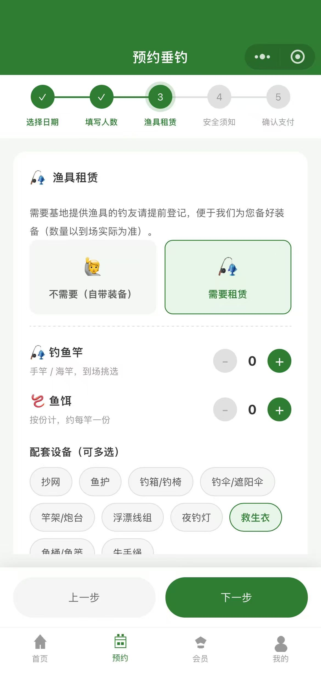
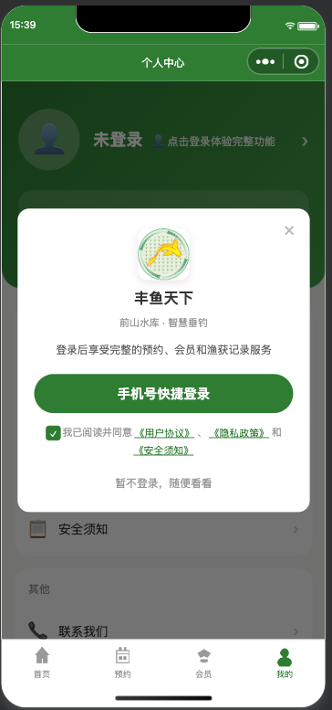
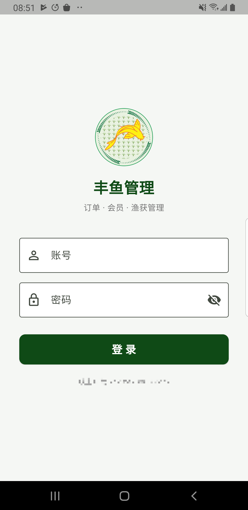
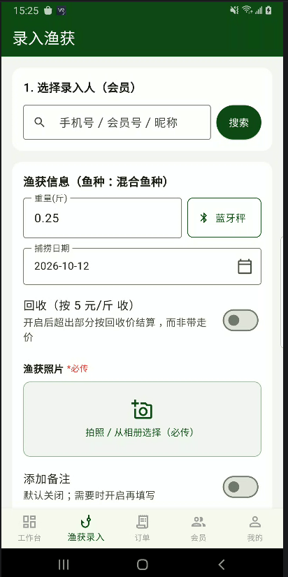
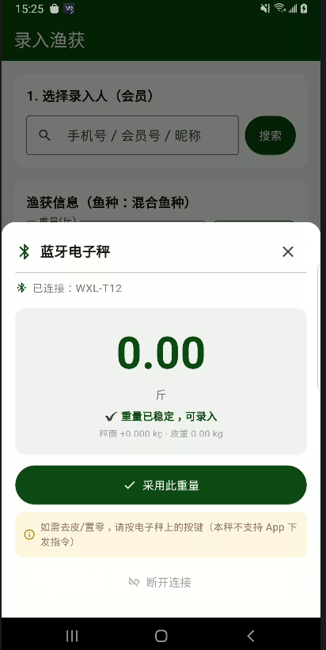
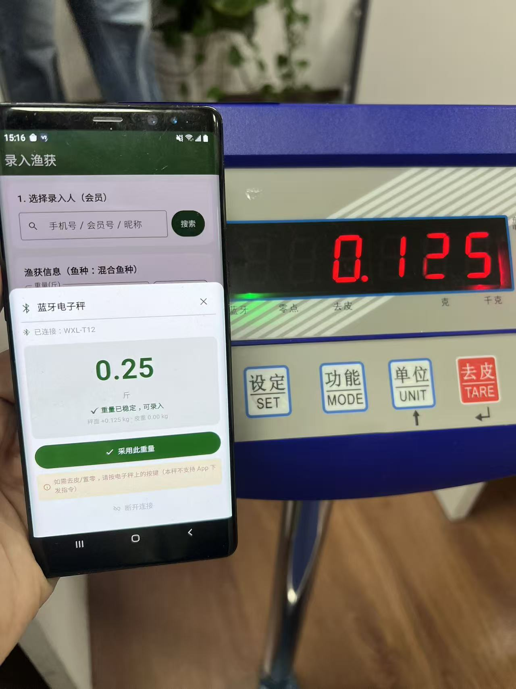
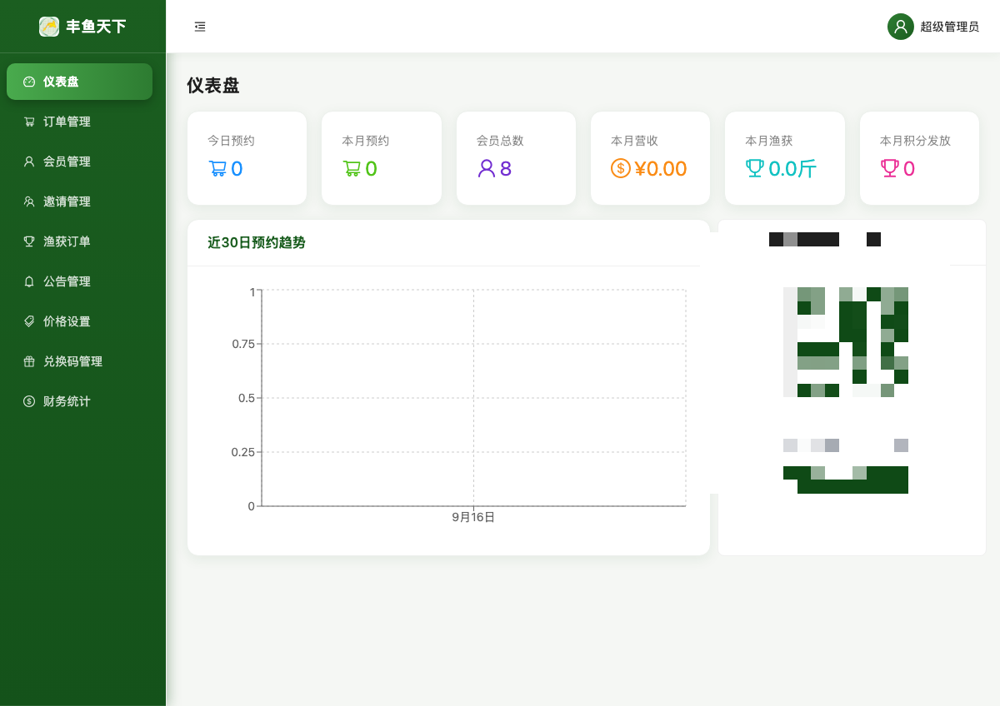
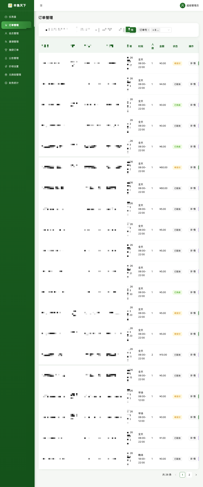
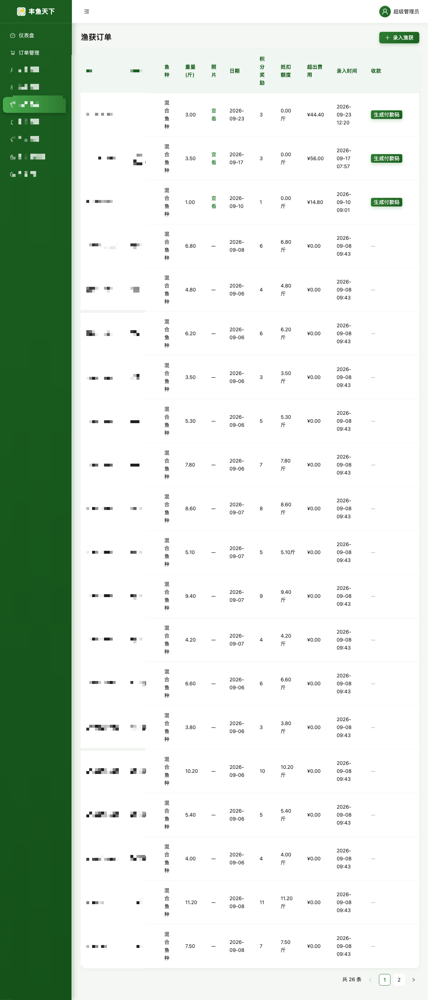

# 丰鱼天下 · 水库垂钓预约平台

一套完整的水库/钓场预约业务系统，C 端微信小程序 + 安卓/iOS 管理 App + Web 管理后台。

> ⚠️ **本仓库已脱敏开源**：后端域名、微信 AppID、客服电话、管理端二维码均已替换为占位符或打码。
> 部署前需替换的位置见各子项目的 README。

## 功能概览

- **预约**：按日期 + 时段（早场/午场/晚场/全天）预约钓位，微信手机号快捷登录
- **渔获**：现场称重大小（支持蓝牙电子秤直连读数）、按会员等级计价（带走/回收）、福利额度、排行榜
- **渔具租赁**：客户预约时登记渔具需求（鱼竿/鱼饵/抄网/救生衣等），场地方现场结算
- **会员**：普通/银卡/金卡/钻石，积分、折扣、等级权益
- **管理端**：订单管理、会员管理、渔获订单、公告、价格设置、兑换码（小程序码批量生成）、财务统计

## 仓库结构

```
├── miniapp/      微信小程序 · C 端预约（Taro 4 + React 18 + TypeScript）
├── field-app/    安卓 + iOS 管理 App（Flutter / Dart，跨端同源）· 场地方现场管理
└── admin-web/    Web 管理后台（Vite + React 构建产物）
```

## 界面预览

### 微信小程序（C 端）

| 预约渔具租赁 | 个人中心 |
|---|---|
|  |  |

### 管理 App（场地方，安卓 / iOS 同源）

| 登录 | 渔获录入 | 蓝牙秤读数 |
|---|---|---|
|  |  |  |

<details>
<summary>蓝牙秤真机实测（App + 电子秤同框）</summary>


</details>

### Web 管理后台

| 仪表盘 | 订单管理 | 渔获订单 |
|---|---|---|
|  |  |  |

> 说明：演示截图中涉及真实用户信息（昵称/手机号/会员号）的部分已做马赛克处理；
> 仪表盘中的 App 下载二维码已打码（其中编码的是线上环境下载地址）。

## 各端快速开始

### 1. 微信小程序（miniapp/）

```bash
cd miniapp
npm install
npm run dev:weapp     # 微信开发者工具导入本目录
```

部署前替换 `src/utils/config.ts` 的 `YOUR-API-DOMAIN`、`wx0000000000000000`，详见 `miniapp/README.md`。

### 2. 管理 App（field-app/，安卓 + iOS）

```bash
cd field-app
flutter pub get
flutter run                 # 自动选当前连接的设备（安卓/iOS 均可）
```

- **安卓**：`flutter build apk`；部署前替换 `lib/config.dart` 的 `YOUR-API-DOMAIN`（后端 API 地址），
  并自行配置 Android 签名（`android/app/build.gradle.kts` 的 signingConfigs 已注释，构建前需填入你自己的 keystore）。
- **iOS**：`flutter build ios`（或 `ios/Runner.xcworkspace` 用 Xcode 打开后 Archive）；
  `ios/Runner/Info.plist` 已配好蓝牙（电子秤）与相册权限；需 Apple 开发者账号签名
  （免费个人账号可自签，7 天有效）。Bundle ID `com.fytx.fytxFieldApp` 可按需修改。

### 3. Web 管理后台（admin-web/）

`admin-web/` 为**构建产物**（Vite + React 打包后的静态文件，含 `dist` 目录结构：
`index.html` + `assets/` + 蓝牙秤/渔具结算等注入脚本），直接放到任意静态服务器即可：

```bash
npx serve admin-web     # 或 nginx/caddy 指向该目录
```

> 本仓库未包含管理后台的前端源码（历史原因，早期以单文件注入方式迭代）；
> 构建产物内已脱敏（`index.html` 中 App 下载链接/二维码地址已替换为 `YOUR-API-DOMAIN`）。

## 后端

后端 API（Node.js + Express + TypeScript + MySQL + 微信支付 APIv3）**未包含在本仓库**，
各前端通过 `YOUR-API-DOMAIN/api/*` 调用。

## 安全与合规

- 微信登录：`wx.login()` code → 后端换 openid/token（静默登录，不弹窗）
- 管理端登录：账号密码 + token 会话
- 演示数据均为测试环境数据

## License

MIT
